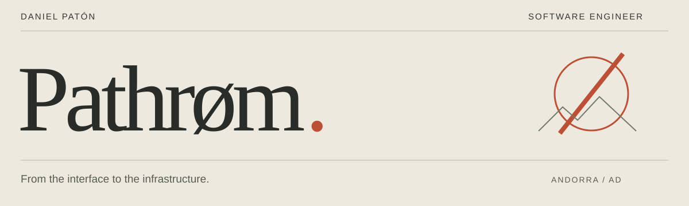
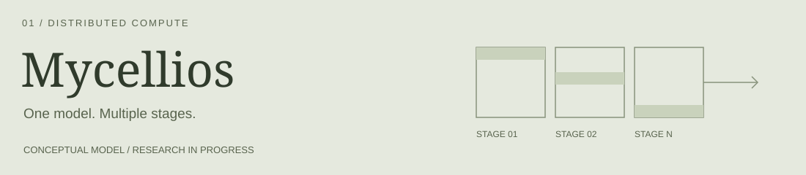

<strong>Hi, I'm Dani.</strong> I build software, from the interface to the infrastructure. Currently interested in applied AI, useful developer tools and decentralized systems.

<a href="mailto:daniel.paton.lr@gmail.com">Email</a> · <a href="https://www.linkedin.com/in/danielplr">LinkedIn</a> · <a href="https://github.com/pathrom">GitHub</a>

<h2>Selected work</h2>
<h3><a href="https://github.com/Mycellios/mycellios">Mycellios</a> — distributed AI inference</h3>

A local-first platform exploring how GPUs on different computers can run a partitioned model through a coordinated, streaming inference route.

<strong>Focus:</strong> model partitioning, worker orchestration, streaming APIs and execution evidence. <strong>Status:</strong> in development. Multi-host performance has not yet been published. Blockchain settlement is a future extension; no public token has launched.

<a href="https://github.com/Mycellios/mycellios">Explore the project →</a>

<h2>Engineering interests</h2>
<ul><li><strong>Applied AI:</strong> useful integrations, automation and tools that connect models to software.</li><li><strong>Infrastructure:</strong> reproducible environments, CI/CD, observability and dependable services.</li><li><strong>Decentralized systems:</strong> distributed inference, smart contracts and verifiable execution records.</li></ul>
<h2>Toolkit</h2>

<strong>Build</strong> — TypeScript · Node.js · React · Angular <strong>Data &amp; operations</strong> — PostgreSQL · Docker · Linux · GitHub Actions <strong>Explore</strong> — AI inference · Ethereum · distributed systems

Have a concrete problem to solve? <a href="mailto:daniel.paton.lr@gmail.com">Let's talk.</a>

